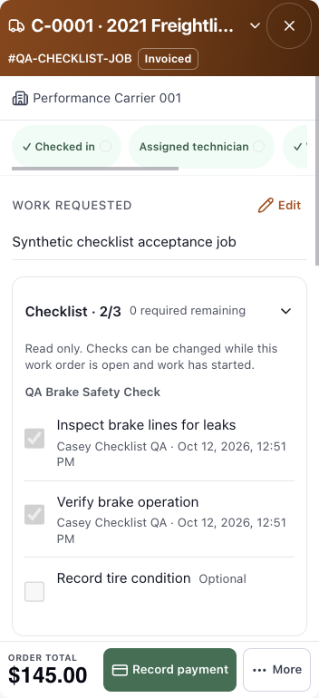
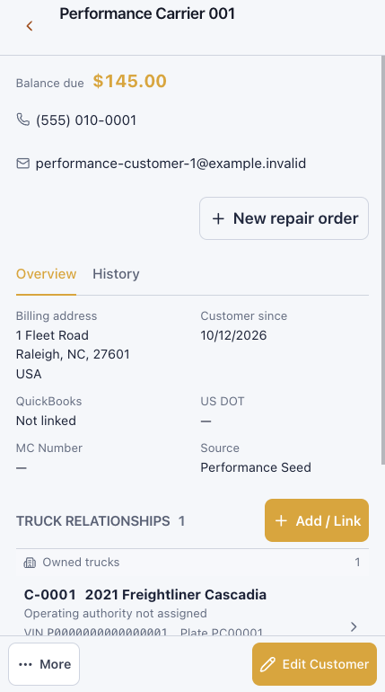

# DB-112 — Shared mobile workspaces

Owner: Frontend & UX. Fast UI lane, existing contracts. Source branch: `codex/mobile-workspace-foundation`, base `34661ad8`.

## Acceptance before implementation

- Desktop queue and record density remain intact.
- Mobile open records use a compact persistent identity/back header, one vertical content scroller, and a short bottom bar. Secondary actions stay accessible without occupying the work area.
- Customer facts remain visible; tax exemption stays in Business settings.
- Existing stage, disabled, invoice, completion and assignment guards remain unchanged; no backend changes.
- Signed-in browser journeys: order edit/save/reload; quantity/duration/rate controls; operation/checklist and assignment flows; customer and contact edit/save/reload; customer/truck/order/back navigation; secondary actions and cancellation; invoiced/locked states. Verify desktop, 390px and 320px, long content and constrained height.
- Physical-device or native keyboard acceptance must be explicitly distinguished from viewport emulation.

## Runtime alignment — 2026-10-13

Implementation is isolated in the checkpoint managed worktree. The user-authorized shared preview remains at `/Users/sergio_m1_promax/.codex/worktrees/ets-parity-preview/truck-pit-stop`, branch `codex/ets-parity-preview`, HEAD846360c3. This intentional split preserves other work and the populated local database. Only owned frontend files will be mirrored for verification and checked for equality.

- Vite PID23640 owns5174; cwd preview/frontend; process proxy origin `http://127.0.0.1:8001`.
- API container `dieselbridge_api_ets-workflow-parity`, host8001, preview/backend bind mount.
- PostgreSQL host `postgres`, database `truckpitstop_ets_workflow_parity_20261012`; Alembic168 head.
- Direct API and frontend-proxied readiness healthy (database and Redis). No restart, migration, reset, seed or production data change.
- Fresh signed-in browser opens PERF-0000001 and Performance Carrier001. Development boot badge predates preview HEAD; badge alone is not source evidence.

## Implementation

- Shared compact frame for <=639px and small touch screens <=959px, including landscape. Global app chrome returns on leaving the record; desktop rules remain intact.
- Persistent record identity/back header; one record scroller; short action bar. Secondary actions use one shared Headless UI popover with keyboard/Escape support. Nested technician pickers retain focus and paint above More.
- Customer edit dialog has a fixed compact header/actions and one form scroller. Failed saves preserve drafts; retry and Escape restore focus. Business settings and visible customer facts are unchanged.
- Keyboard resizing uses the visual viewport with a CSS fallback; ignores pinch zoom and removes listeners/styles when leaving compact mode. [API evidence](https://developer.mozilla.org/en-US/docs/Web/API/VisualViewport) distinguishes visual and layout viewports.
- Existing API calls, permission guards, invoice/assignment/completion handlers and financial logic are unchanged. No backend or migration changes.

## Verification

137 focused tests passed across nine files, including the shared menu, nested technician focus, failed customer save/retry/Escape, compact invoice paid/pending guards, customer recovery/navigation, viewport shrink/pan/zoom/cleanup, and DashboardLayout. TypeScript/Vite production build passed. Changed-source lint: zero errors; two existing unchanged dependency warnings in RepairOrdersPage. Diff whitespace check passed.

Signed-in local browser checks completed before the session expired:

- Measured1280px pointer desktop: queue and dense order rows, expanded labor editor, inline customer actions, customer/truck/history navigation, contact edit/save and restored order values.
- Measured390px/320px portrait plus coarse-pointer emulation: customer notes edit/save/reload/restore; local contact creation/reload and later desktop edit; merge dialog open/cancel; truck drill-in and secondary actions; history-to-order navigation.
- Repair-order description edit/save/reload/restore; direct duration15m→30m and rate100→101; quantity2→3; unit price60→61. Restored15m,100,2,60 and total988 verified. Expanded operation controls are reachable.
- Nested More→technician picker initially closed on focus and then painted below More. Both reproduced defects corrected; picker now remains open above More; callback/focus regression test passed.
- Pricing/discount fields initially moved the hidden outer frame on focus. Corrected outer containment to `overflow: clip`; header remains at y0 and only the body scrolls. Pricing popup fields and Apply are reachable.
- Invoiced read-only checklist remains disabled. Record payment opens the form; no payment submitted. More→Void & revise opens the reason/confirmation; Cancel restores the order; no invoice voided or resent.
- Measured320×700 touch invoice: header76px, footer57px, scrolling body567px; one vertical record scroller, no horizontal overflow.
- Measured390×700 customer: header56px, footer57px, body587px; facts visible without collapse.
- Measured740×400 touch landscape: order body corrected from24px to267px; customer body287px. One vertical content scroller in each.
- Measured320×420 constrained-height customer editor: focused Notes and Save/Cancel remain within visible bounds, header53px and footer57px. This is constrained-height evidence, not native software-keyboard/device verification.

Local-only fixture mutation: created `DB112 QA Contact` on Performance Carrier001, role `Desktop and mobile QA`, notes identifying synthetic verification. Reversible customer/order edits restored; phone formatting was normalized by the existing customer save. No records deleted, outbound messages sent, payments recorded, invoice revisions or production writes.

## Remaining evidence boundary

The local session expired during the final Back/navigation recheck. User sign-in requested; final operation and final-source navigation acceptance pending. Physical iPhone/Android and native Safari keyboard testing are not claimed. ETS parity remains paused. This branch is not merged or deployed.

## Preview file identity

All owned frontend product files match the intentional shared preview byte-for-byte. Development boot badge remains historical; file identity and rendered UI are the source evidence.

- `frontend/src/components/layout/DashboardLayout.tsx` — `3081a8b6447b5c0f`
- `frontend/src/features/customers/CustomerDetailFooter.tsx` — `e701aca35b45d65f`
- `frontend/src/features/customers/CustomerFormModals.tsx` — `d45e64d00c05324d`
- `frontend/src/features/customers/CustomerVehicleFooter.tsx` — `a661092b93b3edc4`
- `frontend/src/features/repair-orders/PriceBuilderPanel.tsx` — `eda8fb439b360923`
- `frontend/src/features/repair-orders/RepairOrdersPage.tsx` — `d2689817ed1b4f76`
- `frontend/src/features/repair-orders/StartWorkAction.tsx` — `50ee973474cb5de6`
- `frontend/src/components/WorkspaceActionOverflow.tsx` — `cc8cd3115a876d25`
- `frontend/src/components/workspace-mobile.css` — `d23b5f43ff8b195b`
- `frontend/src/hooks/useCompactWorkspace.ts` — `fb5604fc5b061e71`
- `frontend/src/hooks/useWorkspaceViewport.ts` — `e05b490b22859f74`
