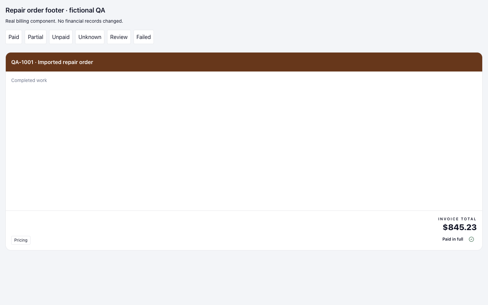
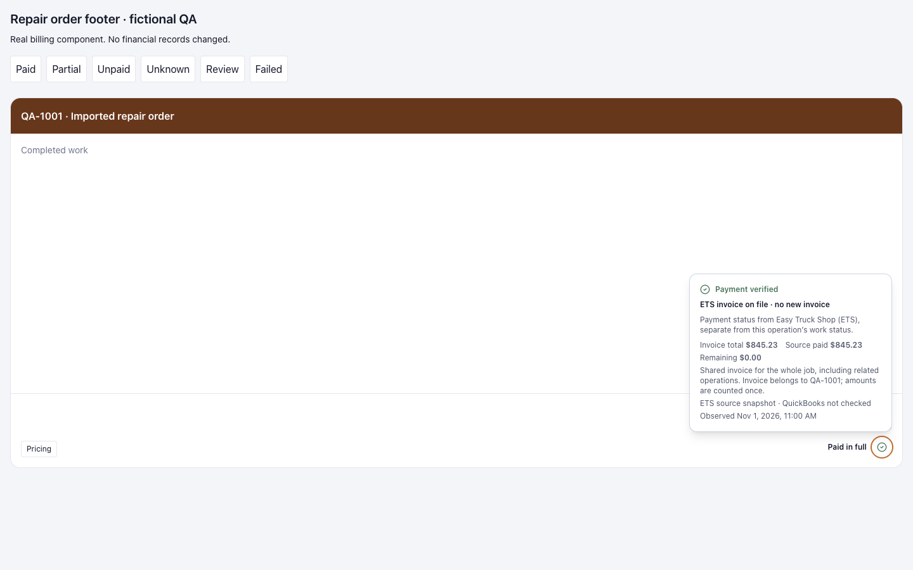
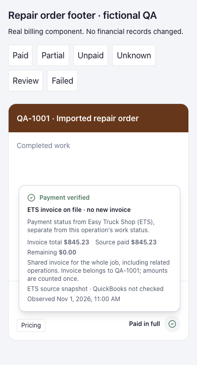

# DB-139 — ETS footer clarity

Accountable owner: Frontend & UX. Fast UI lane; presentation only. No API,
permission, financial calculation, migration, payment action, or dependency changes.

## Acceptance

- Keep invoice total and supported payment status visible, without repeated ETS labels.
- Display Balance due only for a valid, strictly positive supported remaining amount.
  Unknown and failed evidence must never imply zero or a healthy status.
- Explain ETS provenance, recorded amounts, review reasons and shared whole-job scope
  in one hover/focus/tap surface. Preserve existing severity rules and warnings.
- Support Escape, outside activation, keyboard focus, pointer hover and touch toggle.
  Portal above the footer; remain inside desktop and mobile viewports.
- Preserve native-order billing and existing tenant/session query boundaries.

## Runtime alignment

2026-11-01, branch `codex/ets-footer-clarity`, base
`0b902552e4d0aec62b96a1284b7c9cc675c063ef`, with scoped uncommitted source edits.
Frontend http://127.0.0.1:5203, PID95022, cwd this worktree's frontend.
API http://127.0.0.1:8043, container `dieselbridge_api_ets-footer-clarity`,
backend bind mount from this worktree. Intended8021 conflicted with another local
listener; preserved it and used8043. DB `truckpitstop_db042_qa`, Redis12,
current/head migration `196_historical_owner_self_review`; no migration or reseed.
Direct and Vite-proxied `/health/ready` both ready, DB and Redis ok.
Signed-in runtime badge and actual native-order route verified.

## Browser evidence

The retained local QA database has two fictional native orders and no imported ETS
orders. No billing records were created or changed. Signed-in Repair Orders was
checked on desktop and390px: native Order Total $0.00 and actions retained, no page
horizontal overflow. Imported footer browser acceptance used the real production
`ImportedBillingDetails` component with explicit fictional props in a local-only
preview at http://127.0.0.1:5203/footer-qa.html. Integration with the real
PriceBuilderPanel and page is covered by component tests, not claimed as a
signed-in imported-order runtime journey.

-1440px: concise paid summary; hover opens; Tab focus opens; Escape dismisses.
-390px: click/toggle and outside dismissal; partial balance $645.23 visible;
  zero balance hidden; unknown/failed states retain warnings and no false amounts.
-320px: review tooltip fits x16..304, y293..611; no horizontal page overflow.
-Review state still warns even when paid; shared scope explains the whole job,
  owning order and amounts counted once. Unverified amounts remain Unavailable.
-Tooltip repositions on resize, stays above footer and outside clipping containers.
-Physical-device touch was not available through IAB; touch pointer sequence toggle
  and outside-touch behavior are covered by focused automated interaction tests.
-Temporary viewport/touch overrides cleared. User production tabs untouched.

Fictional-only screenshots:

## Checks and release state

Focused suite: importedBilling, PriceBuilderPanel.pending-feedback and
RepairOrdersPage.imported-billing.128 tests, including exact decimal precision,
malformed/unknown/zero amounts, source/session holds, touch and native billing.
TypeScript/production build, scoped lint and diff check recorded in the PR.
Local checks pass:128 tests, TypeScript/Vite build, changed-source lint (7 files) and diff check.
[Draft PR740](https://github.com/mecaniser/truck-pit-stop/pull/740).
No merge or production deployment is claimed. Protected CI and release remain
pending. Local-only preview entry files are not part of the product diff.
