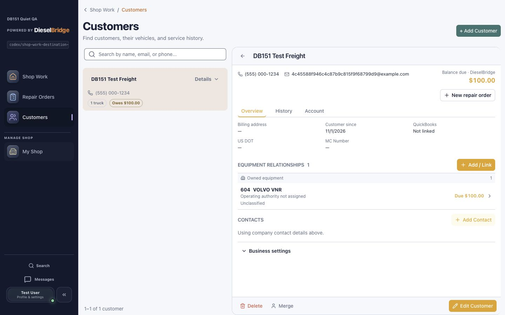
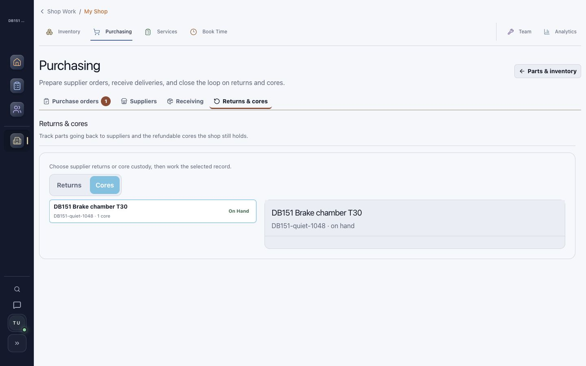

# DB-151 destination layout regression

Date: 2026-11-01 (America/New_York). Accountable owner: Frontend & UX. Fast UI lane. Branch: `codex/shop-work-destination-layout`, based on current main `e28b92b5`. Implementation: `a738729f`.

## Cause and correction

Standalone return controls introduced by the Overview handoff became extra direct grid children. Customers auto-placed its full-width page heading after the explicitly positioned list/detail. Purchasing assigned its flexible third row to the tabs and created an implicit fourth row for the content. The result matches the user's screenshots: Customers heading at the bottom and large blank areas in Purchasing.

Removed those standalone controls from loaded Customers, Purchasing and Inventory. The existing shell breadcrumb now carries the safe Overview return URL. Existing customer-detail back and unavailable-state recovery remain available. Customers' desktop page heading also explicitly occupies row1. APIs, exact selections, financial behavior and authorization are unchanged.

The normal `account_review_only` source state is a coverage limitation, not account identity verification or a shop task. It no longer creates an attention warning or generic Customers action. A quiet scope note explains that invoice balances are reviewed in each customer's Account tab. Genuine unavailable/incomplete billing data remains visible without an arbitrary directory link. Exact customer-account candidates retain their record destinations. Restricted/disabled sources stay hidden; unknown balances never become zero or an all-clear claim.

## Automated verification

72 focused tests pass: Overview14, Purchasing10, staff shell17, customer workstation31. Coverage includes safe breadcrumb returns for all canonical destinations, repair queue return precedence, deep-linked customer Account identity, missing/foreign customer recovery, header order, Purchasing's three structural regions, and truthful partial/error/restricted financial states. An initial customer test raced the unavailable panel; it now waits for the existing recovery control rather than the removed always-present duplicate.

TypeScript/Vite production build and shared-control guard pass. Changed-source lint passes with no new violations across9 files. Full-file ESLint reports9 pre-existing errors and2 warnings in InventoryPage; baseline comparison confirms none were introduced. Diff checks pass. Protected PR CI remains the integration gate.

## Actual local browser acceptance

Signed in to the isolated Quiet QA tenant, using persisted local records and real API responses:

- Shop Work core action opens the exact core and Cores tab. Breadcrumb returns to Overview. Reload preserves exact core selection.
- Desktop Purchasing header, tabs and content are separated by16px gaps; no flexible empty row sits between them.
- Customers with an Overview origin and selected record keeps its heading above search/list/detail. Measured heading top56, search/detail top133.55 at desktop. Account selects that same customer; reload preserves the tab/identity.
-390px customer Account fits the viewport and its existing detail Back returns to Overview. Mobile core page width/scroll width both390; header/tabs/content remain in order with16px gaps and scrollable content.
- Inventory task still opens exact Brake chamber T30, with the shell breadcrumb returning to Overview and no added root link.
- Both Day and Night appearances inspected. Local QA appearance restored to Night; temporary viewport override reset. No business record, invoice, payment, supplier order, or provider action was submitted.

The local clone initially remained at migration196 while current main requires197; customer loading failed with missing source-debt schema. After announcing this setup correction, applied the existing197 migration only to isolated `truckpitstop_db151`. Customer loading and Account navigation then passed. No schema file changed in this PR; production and shared databases were untouched. Local billing classification remains unavailable, and the UI truthfully reports this; routine `account_review_only` coverage is verified in component tests rather than fabricated in the browser.

## Runtime alignment

Frontend `http://127.0.0.1:5215`, PID27010, serves the implementation worktree's `frontend` on `codex/shop-work-destination-layout`. Vite proxy explicitly targets8041. Container `dieselbridge_api_db151` maps127.0.0.1:8041 and mounts the same checkout's `backend` at `/app`; database host/name `postgres/truckpitstop_db151`, Alembic197 matches repository head. Frontend-proxied readiness passes with DB/Redis ready. Startup badge records base `e28b92b5`; process/source ownership and rendered corrections verify the subsequent edits. Local runtime is **aligned and browser-verified**. Shared5173/8000 services are untouched.

## Visual evidence

Synthetic local QA records only:

[Mobile core](assets/db151-destinations/core-destination-mobile-fixed.png) · [Mobile Account](assets/db151-destinations/customer-account-mobile-fixed.png)

## Release status

In Review; [draft PR751](https://github.com/mecaniser/truck-pit-stop/pull/751) published, protected CI pending. Prior PR736 is merged; that does not release this regression fix. No merge, deployment or production acceptance for this change. Not Done.

## Repair Orders omission returned by the user, 2026-11-01

The earlier destination acceptance missed the Repair Orders root return button. The user's screenshot is a valid gate failure: the extra button became the first grid cell, moving the ledger right and the detail panel to the next row. Prior completion language was too broad.

Removed that duplicate root control. The existing detail Close and shell breadcrumb retain the fixed Overview return. Updated the repair regression to assert the ledger is the first workspace child, the inline detail remains present, no duplicate return button exists, and an untrusted return parameter cannot redirect Close.

The visual check also found neutral repair text inheriting Night colors on an intentionally white sheet, plus fixed dark foregrounds. The modern Price Builder now pairs neutral body, footer, form, heading, metadata and mobile-customer colors with the existing workspace tokens. Semantic header/status colors and financial behavior remain unchanged.

### Fresh browser acceptance

Performed through the signed-in isolated local QA clone, using real existing fixture records and UI navigation. A separate QA tab avoided interference with the user's tab.

| Journey | Observed result |
| --- | --- |
| Overview closeout action | Opens `DB151-quiet-1049`, exact selected ID `4c84304d-5f47-4367-9410-7e01a7d9027c` and Ready to Close queue. |
| Desktop, 1280px | Ledger x236/w300 and detail x548/w720, both y56/h664; no horizontal document overflow or extra root return control. Initial wider user viewport also had both panes at y56. |
| Phone, 390x844 | Selected detail x0/y0/w390/h844; document width390; Close target44x44 at x338/y4. |
| Reload | Same exact selected repair and queue restored. |
| Next/previous record | Moves between completed1049 and invoiced1048; selected record and working layout update together. |
| Close, desktop/phone | Returns to `/dashboard?work_view=overview`. |
| Zero active jobs | Active work shows its empty state; Overview still exposes closeout, purchase draft, core, supplier return, stock and upcoming delivery. |
| Purchase draft | Actual Overview action opens PO209 (`9b2ad293-6363-4318-8d1f-abcb2b8faf6c`). Header, tabs and content remain contiguous. |
| Core | Actual action selects core `aad78fdc-813e-42fe-821f-6132308b8229`, Brake chamberT30, on hand. |
| Supplier return | Actual action selects R18 (`6ef8bb1c-2db7-41dd-9428-1f07954c005b`), shipped. |
| Receiving | Actual upcoming-delivery action selects PO208 (`0310ea7c-2fd0-4ea8-bf5d-91dc485f25b1`), submitted,6 units awaiting receipt. |
| Inventory | Actual action selects part `021d51e8-2c54-4d7a-aede-a864f46165eb`, Brake chamberT30. |
| Destination breadcrumbs | Purchasing, core, supplier return, receiving and inventory return to Overview. |
| Customer Account | Direct canonical deep link selects Test Freight's Account tab; Customers heading remains above list/detail. Existing detail Back returns to Overview. No account action is fabricated in the local Overview: billing classification is unavailable in this fixture. |
| Day/Night | Empty and populated repair inspected in both; Night body and order total use matching workspace surface/text. Day pricing disclosure inspected. Original Night preference restored. |
| Unaffected route | Settings/Profile visually inspected; no displaced content. |

No payment, receipt, credit, inventory, invoice or repair-state actions were submitted. Test data has fixture limitations (the invoiced order's saved invoice and current order total differ); this change does not reconcile financial fixtures.

### Automated acceptance

Fresh run:72 passing tests across RepairOrdersPage.schedule(6), DashboardLayout(17), shopWorkNavigation(8), PurchasingWorkspace(10), CustomersPage.workstation(31). This is a different72-test set from the prior receipt; it explicitly includes Repair Orders. Existing tests cover unavailable/denied records, tenant identity changes, and safe destination URLs. Changed-source lint passes across9 files. Final build includes TypeScript and shared-control guard.

Runtime alignment: Vite PID27010 on5215 serves this worktree's frontend; backend `dieselbridge_api_db151` on8041 bind-mounts this worktree's backend, isolated `postgres/truckpitstop_db151`, migration197. Proxied readiness passes database/Redis. Startup badge is base `e28b92b5`; changed-source rendering and measured geometry corroborate HMR rather than treating that badge as current HEAD. No production deployment.

Screenshots:

- [Repair, Night](assets/db151-destinations/repair-order-night-fixed.png)
- [Repair, Day](assets/db151-destinations/repair-order-day-fixed.png)
- [Repair, phone](assets/db151-destinations/repair-order-mobile-fixed.png)
- [Populated repair, Night](assets/db151-destinations/repair-order-populated-night-fixed.png)

## Repair workflow pipeline appearance, 2026-11-02

The previous Night screenshot still showed four nearly white status chips. The stage component chose literal color utilities and a workspace override forced the completed color to pale mint; anchored information panels also had their own white surface. Stages now pass semantic status (positive, current, held or waiting) and mix its ink with the workspace surface. The popup carries the selected appearance across the portal boundary. The inset outline adds no width to the desktop row.

Signed-in browser check, same completed repair 1049: all four Night triggers use a dark teal fill (approximately #1a3340), with mint text (#67e8b5). The four detail panels each opened on #111f33 and dismissed on Escape with focus returned. Day mode retained light fills and white panels for the same record. At 1280px all four triggers start on the same row; at 390px each remains 44px tall and the open review panel fits x54–374 without page overflow. Restored Night mode and the default viewport. No repair-state changes.

Local runtime checked 2026-11-02: Vite PID27010 / port5215 serves the implementation worktree; proxied backend port8041 mounts its backend, isolated postgres/truckpitstop_db151 at migration197. DB and Redis ready. Changed styling verified in the browser, not inferred from the startup badge. The focused workflow and price-builder suites passed (86 tests), including portal appearance and Escape focus restoration. Frontend build and shared-control check passed.

[Desktop Night](assets/db151-destinations/pipeline-night.png) · [Night detail](assets/db151-destinations/pipeline-night-detail.png) · [Desktop Day](assets/db151-destinations/pipeline-day.png) · [Phone, open Night panel](assets/db151-destinations/pipeline-phone-night.png)

## Repair order list selector, 2026-11-02

One selector now owns the list view and optional order status. A work queue is a server projection; overdue is the deadline filter on the archive; status narrows the chosen view. Customer/vehicle-scoped links stay on endpoints that support their scope. Bounded queue counts say “shown” when the server has additional rows.

Signed in to the local DB151 Quiet QA shop at the reported URL: Ready to Close contained completed 1049 and invoiced 1048. Selecting Completed showed 1049 alone with “1 order”; the unfiltered lane value disappeared. Overdue + Completed returned zero. Switching to All repair orders retained Completed and 1049; browser Back restored Overdue with the same selected ID. On a 390px phone the open menu occupied x23–378 with no horizontal overflow; choosing Invoiced showed 1048 only and tapping it opened that exact order. Escape returned focus to the selector. Restored the original desktop route; no order changes.

75 tests passed across ledger, route/schedule, request cancellation, and deleted-order flows. [Desktop menu](assets/db151-destinations/ledger-filter-night.png) · [Phone menu](assets/db151-destinations/ledger-filter-phone.png)

## Familiar navigation on the zero-active-work board, 2026-11-02

Before the change, the DB151 Quiet QA stock task already opened the exact inventory part. Its breadcrumb returned to Overview with focus on the document body. After the change both browser Back from Inventory and the Purchasing breadcrumb restore the originating link. Close from repair 1049 does the same. The board expands to reveal a returning task outside the first group and falls back to its heading if the task has disappeared.

Signed-in local check, 1440px and 390px, with Active work at zero. Purchasing selected the on-hand core for DB151-quiet-1048, even though Inventory lists the same brake chamber title as a separate stock task. A modified click opened the inventory record in another browser tab. No records were changed. Local runtime matches this checkout, Vite PID7423 on port5215, local API8041, postgres/truckpitstop_db151 migration197, database and Redis ready. 51 focused tests passed.

[Return to the core task](assets/db151-destinations/ux-board-return.png) · [Selected core in Purchasing](assets/db151-destinations/ux-core-workspace.png)

## Shop workspace round trips, November 2–3, 2026

| Journey | Before | Signed-in acceptance |
|---|---|---|
| Repair Orders | A fresh queue selection replaced its list history entry. Browser Back could jump to the preceding Customers page. | Preview stays in the list. Opening a repair then using Back or Close restores the queue and focuses the row. |
| Customer or vehicle history | Opening the canonical repair discarded the originating customer context. A fresh customer load could reset History to Overview. | Close and browser Back reopen the same expanded order or truck history link. The directory retains its search. Copying/opening the repair link in another tab also works. |
| Inventory to Purchasing | All parts and the reorder workspace each exposed a “Needs reorder” control. Returning from Purchasing could reset the part and inspector tab. | A single reorder view, applicable stock filters, and an exact part and panel in the URL. The oil filter’s incoming PO opens PO-208. Both the breadcrumb-independent Back to part link and browser Back return to the oil filter’s Ordering tab with the PO link focused. |
| Purchasing | Selecting a record replaced the previous entry. Receiving could suggest retrying a draft that it could never receive. | Back restores the selected draft or core. Eligible submitted PO-208 remains selected in Receiving. A directly linked draft explains its status and opens the exact PO in Purchase orders. |
| Secondary lists | Supplier search and applied Inventory Activity filters reset when the workspace remounted. | The supplier search survives reload. Applied activity filters survive reload and returning through browser history. No-match supplier results no longer suggest an empty supplier directory. |

Six Playwright cases against the DB151 Quiet QA shop. The four main tests cover garage owner and restricted garage admin sessions at 1440px and 390px. Two secondary tests cover vehicle repair history, supplier search, Inventory Activity, and returns/core navigation. The admin’s account tab stayed unavailable through direct navigation. 244 focused frontend tests passed. Frontend build and control checks passed. Tests navigated records without submitting repairs, receipts, credits, payments or stock changes. A temporary local QA admin used for the pass was disabled afterward.

To repeat with the populated local QA shop, supply DB151_QA_URL (loopback only), DB151_OWNER_EMAIL, DB151_OWNER_PASSWORD, DB151_ADMIN_EMAIL and DB151_ADMIN_PASSWORD. From e2e, run Playwright with playwright.db151-local.config.ts. The two runs for each identity are spaced to respect the development API rate limit.

Local runtime verified November 3: Vite PID7423 serves the shop-work-overview frontend on 5215. Its API proxy reaches container dieselbridge_api_db151 on 8041, mounted from the same checkout. Database postgres/truckpitstop_db151 is at migration 197, DB/Redis ready. Screenshots use synthetic shop records.

[Customer History after returning](assets/db151-workspace/customer-history.png) · [Ordering after returning from PO-208](assets/db151-workspace/inventory-ordering.png)

## Shop Work board choices, November 3, 2026

[Before and after, all four views](assets/db151-board/comparison.html). The screenshots use the same signed-in local QA shop. Zero active jobs, two repairs in Closeout, five attention tasks. Billing coverage was incomplete; the board did not treat that as a collectible balance.

| View | Previous decision | Verified behavior |
| --- | --- | --- |
| Overview | Two rows started with the same brake chamber name; identify the task in a separate action column. | One link per task, action first. Review stock opens that Inventory part; Review core return opens its distinct Purchasing core. Back focuses the chosen task. |
| Active work | Search and filter an empty queue, then decide between Overview and Closeout. | With no active jobs, one link opens the first current Overview task, repair 1049 here. Close returns to Active work. The clear shop offers Overview with no invented task. Busy shop search still recovers from a filtered miss. |
| Closeout | Pick from three queues even when two have no records. | If one queue has work it is a label. If multiple have work, they remain selectable. Pending work comes before history; an explicitly requested lane remains available. Invoiced status says Review invoice without claiming a collectible balance. |
| Activity | Event count looked like a workload. Filters had to be chosen again after returning. | History carries no task badge. Events with a repair link to it. Close/reload preserve the chosen filter and Clear activity filters recovers an empty result without reopening Filters. |

**Runtime receipt (2026-11-03, local):** Vite PID7423 at 127.0.0.1:5215 serves shop-work-overview/frontend, branch codex/shop-work-destination-layout, pre-change head 6209fccc. Local proxy points to port8041 and reaches /health/ready. dieselbridge_api_db151 mounts the same checkout's backend; postgres/truckpitstop_db151 migration197, DB and Redis ready. Existing uncommitted Settings edits excluded. Browser verified changed rendering and exact records; no financial, inventory, or repair-state change.

**Verification:** 89 focused frontend tests across six suites, changed-source lint, shared controls, TypeScript and production build passed. Three signed-in Playwright scenarios passed using the populated quiet, busy and clear shops. Quiet repeated all four views at 1440px and 390px. The test spaces those two runs for the local API's one-minute rate limit. Repeat from e2e with DB151_QA_URL (loopback) and DB151_OWNER_PASSWORD: playwright test -c playwright.db151-local.config.ts db151-board-decisions. Screenshot comparison and interactions establish fewer choices; no human decision-time study was performed.
