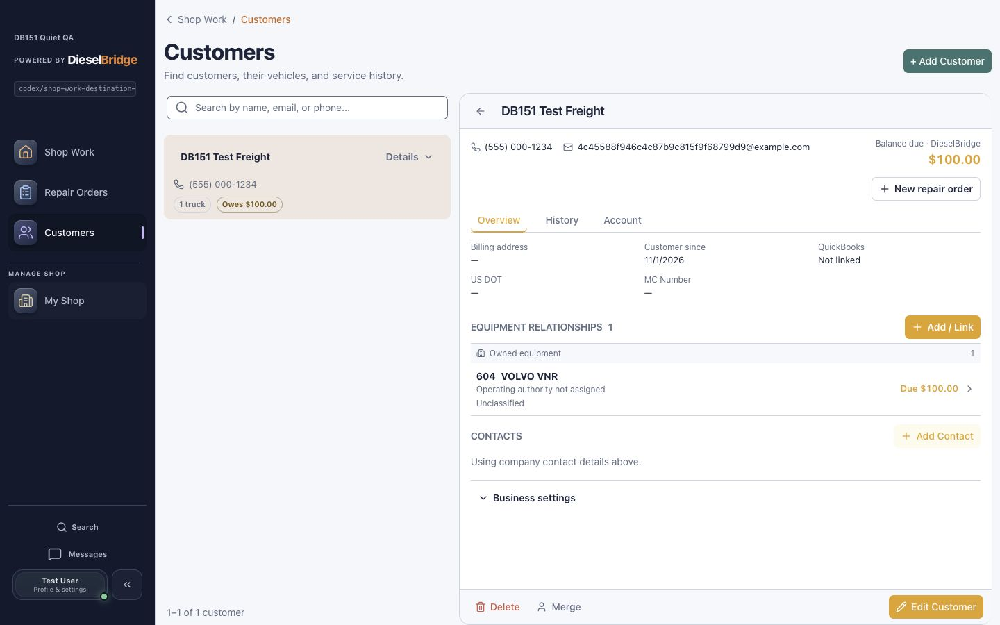
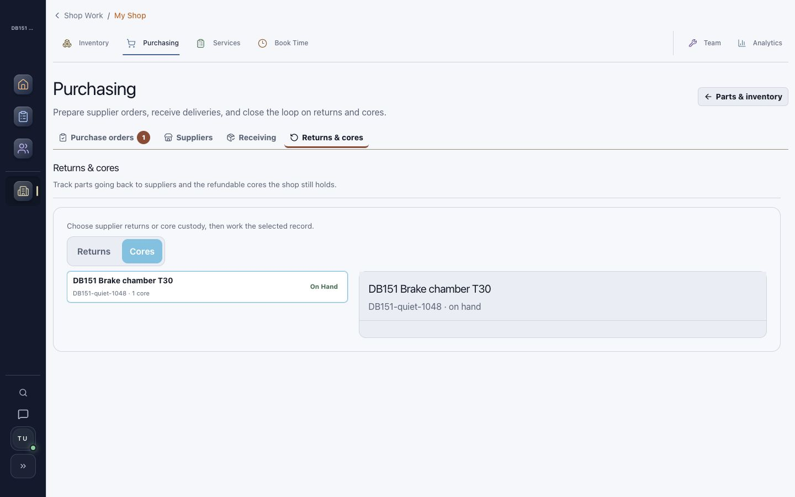

# DB-151 destination layout regression

Date: 2026-11-01 (America/New_York). Accountable owner: Frontend & UX. Fast UI lane. Branch: `codex/shop-work-destination-layout`, based on current main `e28b92b5`. Implementation: `a738729f`.

## Cause and correction

Standalone return controls introduced by the Overview handoff became extra direct grid children. Customers auto-placed its full-width page heading after the explicitly positioned list/detail. Purchasing assigned its flexible third row to the tabs and created an implicit fourth row for the content. The result matches the user's screenshots: Customers heading at the bottom and large blank areas in Purchasing.

Removed those standalone controls from loaded Customers, Purchasing and Inventory. The existing shell breadcrumb now carries the safe Overview return URL. Existing customer-detail back and unavailable-state recovery remain available. Customers' desktop page heading also explicitly occupies row1. APIs, exact selections, financial behavior and authorization are unchanged.

The normal `account_review_only` source state is a coverage limitation, not account identity verification or a shop task. It no longer creates an attention warning or generic Customers action. A quiet scope note explains that invoice balances are reviewed in each customer's Account tab. Genuine unavailable/incomplete billing data remains visible without an arbitrary directory link. Exact customer-account candidates retain their record destinations. Restricted/disabled sources stay hidden; unknown balances never become zero or an all-clear claim.

## Automated verification

72 focused tests pass: Overview14, Purchasing10, staff shell17, customer workstation31. Coverage includes safe breadcrumb returns for all canonical destinations, repair queue return precedence, deep-linked customer Account identity, missing/foreign customer recovery, header order, Purchasing's three structural regions, and truthful partial/error/restricted financial states. An initial customer test raced the unavailable panel; it now waits for the existing recovery control rather than the removed always-present duplicate.

TypeScript/Vite production build and shared-control guard pass. Changed-source lint passes with no new violations across9 files. Full-file ESLint reports9 pre-existing errors and2 warnings in InventoryPage; baseline comparison confirms none were introduced. Diff checks pass. Protected PR CI remains the integration gate.

## Actual local browser acceptance

Signed in to the isolated Quiet QA tenant, using persisted local records and real API responses:

- Shop Work core action opens the exact core and Cores tab. Breadcrumb returns to Overview. Reload preserves exact core selection.
- Desktop Purchasing header, tabs and content are separated by16px gaps; no flexible empty row sits between them.
- Customers with an Overview origin and selected record keeps its heading above search/list/detail. Measured heading top56, search/detail top133.55 at desktop. Account selects that same customer; reload preserves the tab/identity.
-390px customer Account fits the viewport and its existing detail Back returns to Overview. Mobile core page width/scroll width both390; header/tabs/content remain in order with16px gaps and scrollable content.
- Inventory task still opens exact Brake chamber T30, with the shell breadcrumb returning to Overview and no added root link.
- Both Day and Night appearances inspected. Local QA appearance restored to Night; temporary viewport override reset. No business record, invoice, payment, supplier order, or provider action was submitted.

The local clone initially remained at migration196 while current main requires197; customer loading failed with missing source-debt schema. After announcing this setup correction, applied the existing197 migration only to isolated `truckpitstop_db151`. Customer loading and Account navigation then passed. No schema file changed in this PR; production and shared databases were untouched. Local billing classification remains unavailable, and the UI truthfully reports this; routine `account_review_only` coverage is verified in component tests rather than fabricated in the browser.

## Runtime alignment

Frontend `http://127.0.0.1:5215`, PID27010, serves the implementation worktree's `frontend` on `codex/shop-work-destination-layout`. Vite proxy explicitly targets8041. Container `dieselbridge_api_db151` maps127.0.0.1:8041 and mounts the same checkout's `backend` at `/app`; database host/name `postgres/truckpitstop_db151`, Alembic197 matches repository head. Frontend-proxied readiness passes with DB/Redis ready. Startup badge records base `e28b92b5`; process/source ownership and rendered corrections verify the subsequent edits. Local runtime is **aligned and browser-verified**. Shared5173/8000 services are untouched.

## Visual evidence

Synthetic local QA records only:

[Mobile core](assets/db151-destinations/core-destination-mobile-fixed.png) · [Mobile Account](assets/db151-destinations/customer-account-mobile-fixed.png)

## Release status

In Review; [draft PR751](https://github.com/mecaniser/truck-pit-stop/pull/751) published, protected CI pending. Prior PR736 is merged; that does not release this regression fix. No merge, deployment or production acceptance for this change. Not Done.
