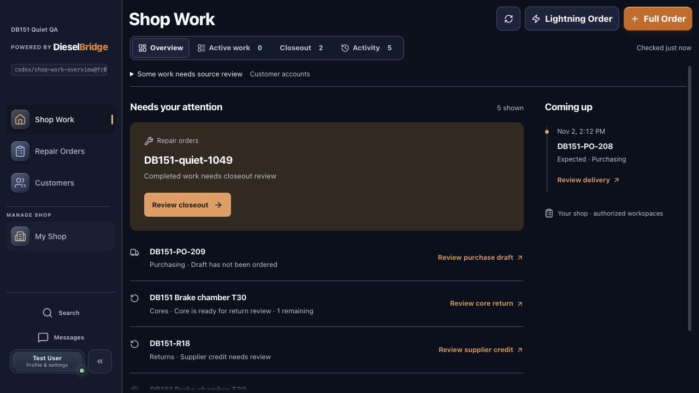
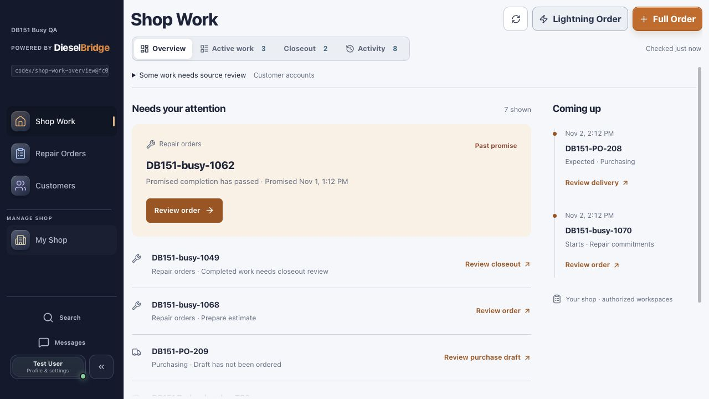
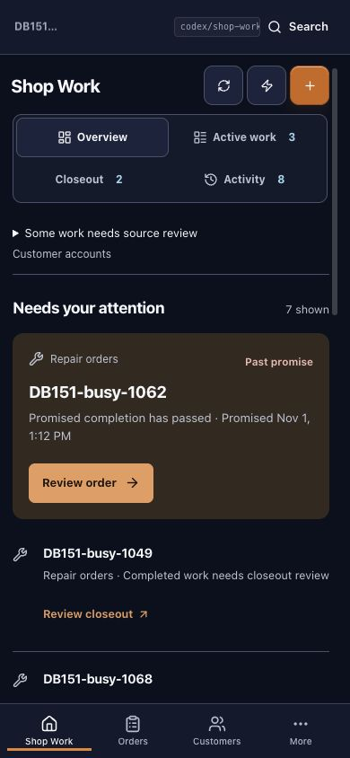
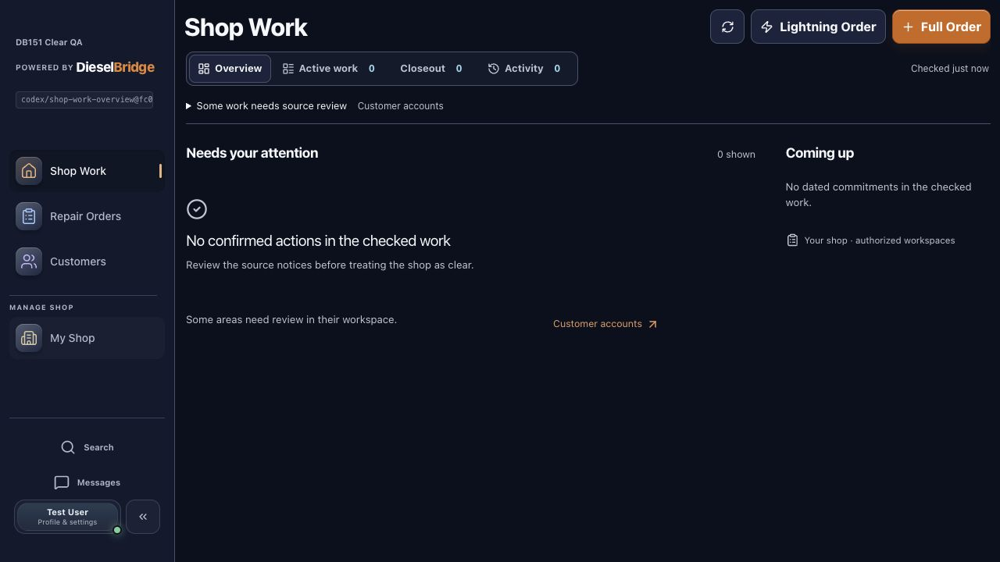
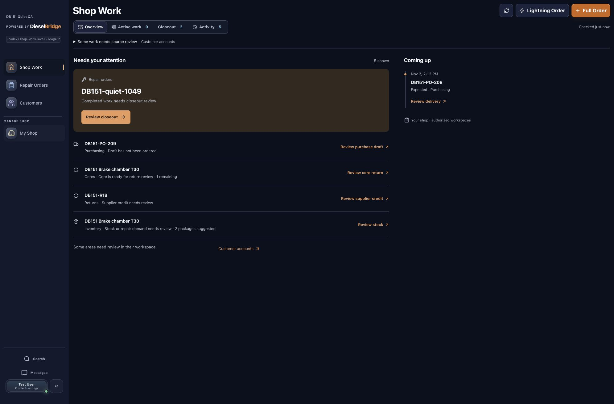

# DB-151 Shop Work Overview — implementation evidence

Date: 2026-11-01; runtime rechecked19:27:55 UTC. Accountable owner: Frontend & UX. Branch: `codex/shop-work-overview`.

## Outcome and scope

Shop Work opens on Overview in the Modern workspace. A prioritized stream identifies real repair, closeout, inventory, purchasing, return, core and authorized customer-account review records. A separate timeline contains actual scheduled starts, promised finishes and supplier delivery dates. Active work and Closeout remain existing views; their counts do not become oversized duplicate widgets.

Every record action uses the existing owner workspace. Inventory retains the selected part; ordering continues into Purchasing. Purchase orders, receiving, returns and cores retain exact IDs and views. Repair orders open the existing detail workspace, including services, labor/book time, schedule and closeout controls. Account review opens the exact customer Account view. Fixed `shop_work=overview` navigation supports returning without arbitrary return URLs.

The endpoint reads tenant-scoped persisted data. It does not create operational records, issue invoices, collect payments, order parts, or change inventory. No schema migration or dependency change. Reordering subtracts outstanding ordered supply; linked core/return obligations are deduplicated. Existing financial classification and settlement gates remain enforced. Account signals are review candidates, not verified collectible dollar totals; unavailable classification remains explicitly incomplete. Imported ETS balances are not silently treated as native debt.

Contract: [DB-151 read model](../contracts/db151-shop-work-overview.md). Research and design rationale: [starting board](../research/DB151_SHOP_WORK_STARTING_BOARD.md), [design revision](../research/DB151_SHOP_WORK_DESIGN_REVISION.md).

## Local runtime receipt

Implementation checkout: `/Users/sergio_m1_promax/.codex/worktrees/shop-work-overview/truck-pit-stop`; base HEAD `fc0de9555ffabc5879a3edcdfcb13b1071c85d1b` plus task changes during browser acceptance. The dev branch indicator showed `codex/shop-work-overview@fc0de95`; rendered Overview and destination behavior corroborated served changes.

- Frontend: `http://127.0.0.1:5215`; Vite PID58810, implementation frontend working directory; proxy target8041.
- Backend: `http://127.0.0.1:8041`; container `dieselbridge_api_db151`, implementation backend mounted at `/app`.
- Database: dedicated local clone `truckpitstop_db151`, based on populated `truckpitstop_db139_shared`; migration196 matches repository head. Shared source data was not migrated or reseeded.
- Dedicated Redis; no task worker/scheduler. Existing development/provider settings retained. Shared5173/8000 runtimes preserved.
- Direct and frontend-proxied `/health/ready` passed with database/Redis ready. Signed-in IAB flows verified real responses from the dedicated backend.
- Three synthetic tenants were inserted only in the dedicated local clone: busy, quiet and clear. No response mocking or synthetic production fallback. Fixtures are verification data, not product code. No production mutation, supplier submission, customer message, invoice issuance or payment occurred.

## Browser acceptance

| Scenario | Observed result |
| --- | --- |
| Quiet shop: zero active jobs | Five tasks remain: unbilled completed repair, purchase draft, core, shipped return credit review, low stock. Future PO remains in Coming up. |
| Completed repair action | Exact `DB151-quiet-1049` opens; Close repair order returns to Overview. |
| Inventory action | Exact Brake chamber T30 inspector opens with available3/reorder5, recommended2. Ordering stages that part into Purchasing; missing supplier remains visibly blocked. No supplier order is submitted. |
| Purchase draft | Exact `DB151-PO-209` opens in Purchase orders. |
| Delivery | Exact `DB151-PO-208` opens in Receiving with correct oil-filter line and6 units remaining. |
| Vendor return | Exact `DB151-R18` opens in Returns with the existing credit-review controls. |
| Core | Exact core record opens in Cores, linked to the correct repair; reload preserves selection. |
| Customer account | Direct canonical deep link selects the exact customer and Account tab. Existing classification warning remains; no fabricated collectible amount. Candidate generation/routing covered by automated fixtures. |
| Busy shop | Overdue held repair leads; estimate and completed work remain actionable; scheduled repair and expected PO appear once in Coming up. |
| Estimate / labor | Exact estimate repair opens; existing Labor tab exposes Labor Book Time entry. |
| Schedule | Exact scheduled repair opens; its existing schedule dialog shows persisted start and promised finish in shop timezone. |
| Clear shop | Overview shows no confirmed actions and no dated commitments, while incomplete account source remains visible. Active work is empty. |
| Tenant switch | Original test exposed stale Closeout rows; corrected shared Dashboard query identity passed actual busy-signout-clear-signin without reload: Active0, Closeout0, no prior rows. |
| Foreign selected PO | Empty tenant cannot load another tenant's PO; shows unavailable record with Retry and return path, never a substitute first record. |
| Responsive |390×844 verified; four view tabs use two columns, all Overview content remains within viewport. No overflowing main/section elements. |
| Appearance | Actual day and night modes rendered readable Overview headings, task hierarchy and restrained copper actions. |

Screenshots contain synthetic local data only:

## Gates and corrections

Architecture completed before parallel endpoint/UI work. Independent reviewer had no implementation participation. Initial review returned four findings: insufficient permission/session query identity, timestamp borrowing from Closeout, missing refresh on Overview re-entry, and missing origin/overflow navigation. All were corrected. Initial independent checks passed64 backend tests and133 frontend tests, plus TypeScript and a real QueryObserver permission-revocation probe. Mobile/theme follow-up passed26 focused tests.

Actual browser testing then exposed the incumbent Closeout cache across sign-in identities. All Dashboard query families now share tenant, actor, role, payment grant and session epoch, with no previous-context placeholder. Independent follow-up passed42 focused tests including a real QueryClient with global keepPreviousData and a delayed new-tenant response. Follow-up scoped the canonical destination read caches and their direct cache writers. Same-identity pagination is retained; a new tenant, actor, role, permission set or session cannot inherit previous records. Actual browser retest passed quiet-shop record selection, then signout/signin to the empty tenant with no retained repair, inventory, purchasing or preparation records. Independent final integrated frontend run passed239 tests across13 suites, including delayed/forbidden exact-record cases and inventory optimistic-update regressions. Independent review of the supplied screenshots found no issues; this was evidence review, not a separate browser operator.

Owner backend verification:76 passed across Overview, incumbent WIP and parts operations. Warnings are existing dependency deprecations.

## Release status

Local implementation verified. Independent QA and Security GO for implementation and supplied local-runtime evidence; final TypeScript and production build passed. Changed-source lint passed across23 files. Draft PR and protected CI recorded after publication. Not merged or deployed. Production acceptance remains a release gate; local serving is not production delivery.

## Integrated checkout receipt

Current main through `4645ea6a` was integrated without conflicts as `48b39c98a57c1e9033ad76e869af2dfaa190367b`. The new base changes imported-billing handling and Team styles; no Overview source conflict. Backend76 tests and production build were rerun successfully on the integrated checkout. Changed-source lint against current main reports no new violations across23 files.

Only the task Vite process was gracefully restarted: PID84934 on5215, same implementation frontend cwd; validated branch/SHA stamp now `codex/shop-work-overview@48b39c9`. API container8041 still mounts the same implementation backend and reads local `truckpitstop_db151`, schema196. Direct/proxied readiness passed. Signed-in browser rechecked the quiet shop: Active0, Closeout2, five operational actions, expected delivery and correct new stamp. Local runtime is **aligned and browser-verified**. Later documentation-only receipt commits do not change served application code.

