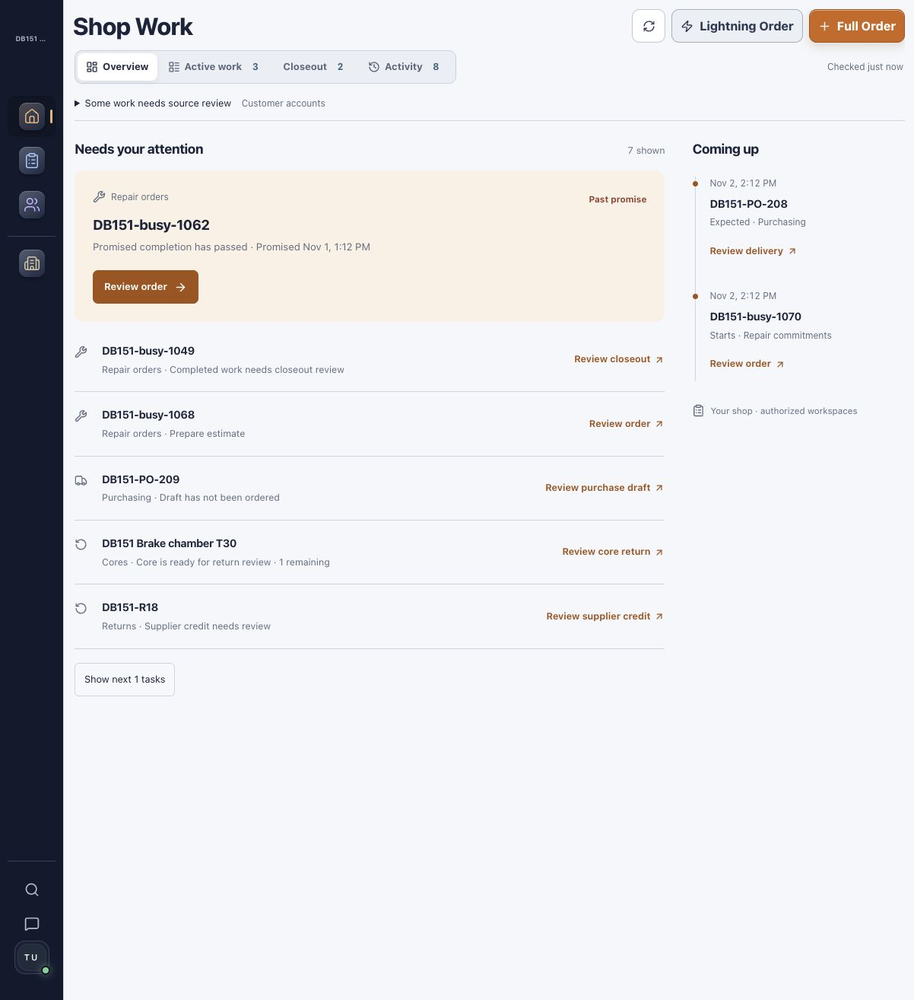

# DB-151 Shop Work Overview — implementation evidence

Date: 2026-11-01; runtime rechecked19:27:55 UTC. Accountable owner: Frontend & UX. Branch: `codex/shop-work-overview`.

## Outcome and scope

Shop Work opens on Overview in the Modern workspace. A prioritized stream identifies real repair, closeout, inventory, purchasing, return, core and authorized customer-account review records. A separate timeline contains actual scheduled starts, promised finishes and supplier delivery dates. Active work and Closeout remain existing views; their counts do not become oversized duplicate widgets.

Every record action uses the existing owner workspace. Inventory retains the selected part; ordering continues into Purchasing. Purchase orders, receiving, returns and cores retain exact IDs and views. Repair orders open the existing detail workspace, including services, labor/book time, schedule and closeout controls. Account review opens the exact customer Account view. Fixed `shop_work=overview` navigation supports returning without arbitrary return URLs.

The endpoint reads tenant-scoped persisted data. It does not create operational records, issue invoices, collect payments, order parts, or change inventory. No schema migration or dependency change. Reordering subtracts outstanding ordered supply; linked core/return obligations are deduplicated. Existing financial classification and settlement gates remain enforced. Account signals are review candidates, not verified collectible dollar totals; unavailable classification remains explicitly incomplete. Imported ETS balances are not silently treated as native debt.

Contract: [DB-151 read model](../contracts/db151-shop-work-overview.md). Research and design rationale: [starting board](../research/DB151_SHOP_WORK_STARTING_BOARD.md), [design revision](../research/DB151_SHOP_WORK_DESIGN_REVISION.md).

## Local runtime receipt

Implementation checkout: `/Users/sergio_m1_promax/.codex/worktrees/shop-work-overview/truck-pit-stop`; base HEAD `fc0de9555ffabc5879a3edcdfcb13b1071c85d1b` plus task changes during browser acceptance. The dev branch indicator showed `codex/shop-work-overview@fc0de95`; rendered Overview and destination behavior corroborated served changes.

- Frontend: `http://127.0.0.1:5215`; Vite PID58810, implementation frontend working directory; proxy target8041.
- Backend: `http://127.0.0.1:8041`; container `dieselbridge_api_db151`, implementation backend mounted at `/app`.
- Database: dedicated local clone `truckpitstop_db151`, based on populated `truckpitstop_db139_shared`; migration196 matches repository head. Shared source data was not migrated or reseeded.
- Dedicated Redis; no task worker/scheduler. Existing development/provider settings retained. Shared5173/8000 runtimes preserved.
- Direct and frontend-proxied `/health/ready` passed with database/Redis ready. Signed-in IAB flows verified real responses from the dedicated backend.
- Three synthetic tenants were inserted only in the dedicated local clone: busy, quiet and clear. No response mocking or synthetic production fallback. Fixtures are verification data, not product code. No production mutation, supplier submission, customer message, invoice issuance or payment occurred.

## Browser acceptance

| Scenario | Observed result |
| --- | --- |
| Quiet shop: zero active jobs | Five tasks remain: unbilled completed repair, purchase draft, core, shipped return credit review, low stock. Future PO remains in Coming up. |
| Completed repair action | Exact `DB151-quiet-1049` opens; Close repair order returns to Overview. |
| Inventory action | Exact Brake chamber T30 inspector opens with available3/reorder5, recommended2. Ordering stages that part into Purchasing; missing supplier remains visibly blocked. No supplier order is submitted. |
| Purchase draft | Exact `DB151-PO-209` opens in Purchase orders. |
| Delivery | Exact `DB151-PO-208` opens in Receiving with correct oil-filter line and6 units remaining. |
| Vendor return | Exact `DB151-R18` opens in Returns with the existing credit-review controls. |
| Core | Exact core record opens in Cores, linked to the correct repair; reload preserves selection. |
| Customer account | Direct canonical deep link selects the exact customer and Account tab. Existing classification warning remains; no fabricated collectible amount. Candidate generation/routing covered by automated fixtures. |
| Busy shop | Overdue held repair leads; estimate and completed work remain actionable; scheduled repair and expected PO appear once in Coming up. |
| Estimate / labor | Exact estimate repair opens; existing Labor tab exposes Labor Book Time entry. |
| Schedule | Exact scheduled repair opens; its existing schedule dialog shows persisted start and promised finish in shop timezone. |
| Clear shop | Overview shows no confirmed actions and no dated commitments, while incomplete account source remains visible. Active work is empty. |
| Tenant switch | Original test exposed stale Closeout rows; corrected shared Dashboard query identity passed actual busy-signout-clear-signin without reload: Active0, Closeout0, no prior rows. |
| Foreign selected PO | Empty tenant cannot load another tenant's PO; shows unavailable record with Retry and return path, never a substitute first record. |
| Responsive |390×844 verified; four view tabs use two columns, all Overview content remains within viewport. No overflowing main/section elements. |
| Appearance | Actual day and night modes rendered readable Overview headings, task hierarchy and restrained copper actions. |

Screenshots contain synthetic local data only:

## Gates and corrections

Architecture completed before parallel endpoint/UI work. Independent reviewer had no implementation participation. Initial review returned four findings: insufficient permission/session query identity, timestamp borrowing from Closeout, missing refresh on Overview re-entry, and missing origin/overflow navigation. All were corrected. Initial independent checks passed64 backend tests and133 frontend tests, plus TypeScript and a real QueryObserver permission-revocation probe. Mobile/theme follow-up passed26 focused tests.

Actual browser testing then exposed the incumbent Closeout cache across sign-in identities. All Dashboard query families now share tenant, actor, role, payment grant and session epoch, with no previous-context placeholder. Independent follow-up passed42 focused tests including a real QueryClient with global keepPreviousData and a delayed new-tenant response. Follow-up scoped the canonical destination read caches and their direct cache writers. Same-identity pagination is retained; a new tenant, actor, role, permission set or session cannot inherit previous records. Actual browser retest passed quiet-shop record selection, then signout/signin to the empty tenant with no retained repair, inventory, purchasing or preparation records. Independent final integrated frontend run passed239 tests across13 suites, including delayed/forbidden exact-record cases and inventory optimistic-update regressions. Independent review of the supplied screenshots found no issues; this was evidence review, not a separate browser operator.

Owner backend verification:76 passed across Overview, incumbent WIP and parts operations. Warnings are existing dependency deprecations.

## Release status

Local implementation verified. Independent QA and Security GO for implementation and supplied local-runtime evidence; final TypeScript and production build passed. Changed-source lint passed across23 files. [Draft PR736](https://github.com/mecaniser/truck-pit-stop/pull/736) is published; protected CI is pending. No merge/deployment authorization or action. Not merged or deployed. Production acceptance remains a release gate; local serving is not production delivery.

## Integrated checkout receipt

Current main through `4645ea6a` was integrated without conflicts as `48b39c98a57c1e9033ad76e869af2dfaa190367b`. The new base changes imported-billing handling and Team styles; no Overview source conflict. Backend76 tests and production build were rerun successfully on the integrated checkout. Changed-source lint against current main reports no new violations across23 files.

Only the task Vite process was gracefully restarted: PID84934 on5215, same implementation frontend cwd; validated branch/SHA stamp now `codex/shop-work-overview@48b39c9`. API container8041 still mounts the same implementation backend and reads local `truckpitstop_db151`, schema196. Direct/proxied readiness passed. Signed-in browser rechecked the quiet shop: Active0, Closeout2, five operational actions, expected delivery and correct new stamp. Local runtime is **aligned and browser-verified**. Later documentation-only receipt commits do not change served application code.

## CI regression correction

First PR run41342437127 on `aee27512` passed protected backend/frontend checks, Playwright smoke and full backend (4448passed/415skipped). The full frontend informational suite found one failing warm-History deleted-order test among2059 tests, plus unhandled errors during unauthenticated teardown. These were real consequences of adding scoped workspace caches: deletion still evicted only the old exact key, and the identity-keyed wrapper could remount a selected record after logout.

Correction: delete evicts the workspace prefix across authorization scopes; the repair workspace does not mount without an actor or while logout is in progress. Regression assertions verify cache removal, deleted reopen, and no selected-record reads after logout starts. The cancellation fixture now supplies a signed-in actor and the existing required pricing preview; the create/attribution assertion is preserved. Owner focused rerun31/31 passed without unhandled errors; independent expanded review and a fresh PR run follow.

Actual signed-in browser regression passed in the isolated busy QA tenant: open History for draft1068, soft-delete through the existing action, return to Overview (Active3→2/actions7→6), immediately reopen exact1068 via Deleted filter (Deleted/Restore controls, no active editor), restore it, then return to Overview (Active3/actions7 and the estimate action restored). No invoice, payment or provider mutation.

Second CI run41343482346 on `5b46bd39` passed protected checks/Playwright but exposed an overstrict new test assertion (2073pass/1failure): a workspace observer legitimately repopulated a fresh deleted snapshot after eviction. Independent source/log review confirmed it was not stale live data. The test invariant is refined to prove a warm live snapshot before delete and only deleted snapshots afterward, retaining immediate Restore UI and no active-panel requests. Application source is unchanged by this test refinement.

## PR736 integration with shared controls and current main — 2026-11-01

Conflict integration is isolated at task-3/dbn736-integration; the active implementation owner's worktree and unpublished Overview refinement remain untouched. Integrates main8021b355 (PR735 shared controls and PR740 simplified ETS footer), plus documentation-only5213d328 release receipt. Eight frontend conflicts preserve both Shop Work query scopes/record returns and main's shared control wrappers. New Overview and return buttons use ControlButton. The merged ETS tooltip also uses ControlButton with icon kind, preserving forwarded ref, pointer/focus/keyboard handlers and ARIA while passing the native-control guard.

Shop Work backend endpoint/service/schema/tests, navigation helper and WebSocket code remain byte-identical to the original published93771ebb parent. No auth, financial, migration or tenant contract is changed by reconciliation.

Local integration validation: production TypeScript/Vite build and shared-control guard pass; affected regression run passes39files/684tests across dashboard, record destinations, customers, inventory/purchasing, repair orders, imported footer and controls. A fresh independent reviewer returns no blocking findings and passes4files/67focusedtests (overlapping the broader run, not additive). No new signed-in browser acceptance is claimed for this merge-only reconciliation; original signed-in flows are recorded above and protected integration CI remains required. Changed-source lint and final exact-head CI pending at this checkpoint.

Existing owner remains accountable for concurrent presentation refinements. Publish only using a fresh remote-head check and normal fast-forward push; preserve any newer owner commit. No PR approval, merge, deployment or production writes.

## Source-status UI correction — 2026-11-01

User review rejected the native full-width source disclosure. The correction follows the Fast UI lane: existing read contract and authorization remain unchanged.

- Compact named status sits beside the attention count. It uses the existing Headless UI popover and semantic warning/appearance tokens. No extra banner, default disclosure marker, or duplicate account footer.
- Partial/unavailable sources retain a visible status and one owner-workspace action inside the anchored explanation. Verified overflow still has its workspace route. Restricted/disabled sources remain absent. Unknown balances never become zero or confirmed collectibles.
- 29 focused Overview and Dashboard presentation tests pass, including zero active jobs, unknown accounts, multiple failures, restricted/disabled sources, actual overflow, destination identity, and keyboard Escape/focus return. Changed-source ESLint passes; Impeccable detector reports no findings.
- Actual signed-in local API-backed Quiet QA tenant: zero active jobs, five actions and an upcoming PO remain visible. Account status opens Customers with the Shop Work return context, and Back restores Overview. Escape restores trigger focus; explicit Close and outside click dismiss correctly.
- Desktop and390px visual acceptance: mobile page width390; panel bounds x27–367, no horizontal overflow. Temporary viewport reset. Synthetic QA records are persisted in the dedicated local clone; no mock UI data or production mutations.
- [Desktop](assets/db151/status-heading.png), [mobile details](assets/db151/status-mobile.png).

This UI follow-up supersedes the source-disclosure visuals in earlier screenshots. PR736 stays draft; no merge/deploy. Previous CI evidence belongs to the prior head and is not evidence for this follow-up head.

Follow-up `npm run build` (TypeScript + Vite) passed. Routine existing bundle-size/Browserslist warnings remain; no build failure.

Remote owner published10de849b during reconciliation. It is preserved as a merge parent; the source-status popover, overflow deduplication, new tests and signed-in screenshots survive. Its native buttons are reconciled to shared ControlButton, with explicit shared geometry on the Headless UI trigger. Fresh affected checks and independent re-review required for this combined head.

Combined owner-follow-up validation:5affectedfiles/85tests and a fresh TypeScript/Vite production build pass. Independent exact-head re-review of68b9b6af mechanically confirms owner10de849b Overview logic unchanged after reversing wrapper/geometry substitutions, with owner CSS/tests byte-identical;24independent tests pass. Counts overlap prior suites and are not additive. Final changed-source lint and protected CI checked separately below.

Final changed-source lint passes across25files against main5213d328. Git diff check clean. Protected CI awaits publication of this combined head.

All seven Quality gates jobs passed on published integrationaa180375, run41347288886: migration/scope, backend critical, frontend dependencies/checks, full backend, full frontend, Playwright smoke. During that run main advanced to72aaee69 (PR743 billing-warning explanations and the same tooltip wrapper). Its only code conflict is equivalent ControlButton prop ordering; resolved exactly to main. Both board histories retained, with main's current lead entry kept first to reduce future prepend collisions. PR743 warning helpers/tests/styles are preserved. Affected regression/build/lint and new exact-head CI required after this necessary main integration; previous green remains historical evidence.

## Authorized release preparation — sequenced hold

November1: User authorizes safe release through the curated queue; orchestrator explicitly directs741 first and requires confirmation that main is stable before736 merge. Latest mainaa549f2e (PR744 retired duplicate display) merges automatically with no conflicts. Existing ShopWork backend logic remains unchanged;70in-memory backend tests covering overview and retired display pass. No deployment configuration or migration changes in this advancement.

The implementation owner is concurrently refining further ShopWork UI and has not published that sweep. It is not included or claimed verified here. Read-only production auth/me confirms the genuine active owner92059ce6… in TruckPitStop tenant828acd84…. No credentials extracted; the temporary preflight tab was closed. Published736 remainsdecaf8dd/draft with7/7CI success. This local main advancement is not a final release candidate until741/main confirmation, the owner handoff and exact-head checks. No ready/merge/deploy/approval or business writes.

## Shop Work consistency sweep — 2026-11-01

Frontend & UX owns this Fast UI follow-up. All four views, filters, empty/recovery states and Lightning Order were reviewed against the compact workspace design. Existing API, permission, financial and data contracts are unchanged.

- Activity now uses chronological day groups and readable record rows instead of oversized date columns and actor regrouping. One named Filters control contains staff/type/date inputs; incomplete coverage uses an anchored status explanation. Loading, denied, unavailable, empty and older-page failures remain distinct. A failed older-page request preserves the visible records and one retry action.
- Active work hides all-zero category controls, Unknown0 and inert pagination only when genuinely empty and unfiltered. Filtered empty states retain recovery; an empty later page retains Previous. Reset closes the filter panel and returns focus.
- Closeout value stays in Closeout, missing value is an em dash, and single-lane rows do not repeat the lane label. Mixed-lane rows retain their labels. Overview lead spacing and retry states are consistent; incomplete empty coverage does not display a success check.
- Lightning Order uses workspace appearance tokens for its form, fields and validation. No creation or financial workflow changed.
- Activity selection is represented in the URL and restored after record navigation; freshness uses Activity's own query timestamp.

### Integrated verification

The draft PR advanced independently to `decaf8dd` during this sweep. Its current-main integration and shared controls were merged into this checkout, preserving all upstream work. Three component conflicts were reconciled by retaining the sweep behavior and applying shared ControlButton/ControlInput and headless-trigger geometry. New styles own color/emphasis; shared controls own size. The historical all-green run41348179512 belongs to `decaf8dd`, not this new sweep.

Final integrated checks: **71 tests across five suites passed** (Overview13, Closeout ledger19, Active work16, Activity6, Dashboard presentation17), changed-source ESLint passed, shared-control guard passed, and TypeScript/Vite production build passed. Diff checks passed. Initial nested-popover focus and reset-focus failures were corrected before this final run. No backend change was introduced by this sweep.

Actual API-backed Quiet QA browser acceptance covers all four views, exact repair selection and return paths, zero active jobs with remaining Overview tasks, filter selection/reset, both date inputs, error/validation styling, desktop/mobile and day/night. No order was created or invoice/payment state changed. Test appearance was restored to Night; viewport override reset. After integration, repeated nested selection/reset, exact1049 record/Back-to-Activity, empty Active, and390px calendar checks pass. Shared filter control measures34px desktop and44px mobile; mobile page/scroll widths are390px and calendar bounds are x54–374/y391.5–756, above mobile navigation. Transient Vite import errors occurred while merge-conflict markers were present; the resolved app subsequently rendered and navigated successfully, with no later error entries.

Runtime receipt, November1 approximately16:05 America/New_York: same `codex/shop-work-overview` implementation worktree, sweep commit `5bf9297a` with reconciled integration changes pending merge commit during checks. Frontend5215/PID92275 serves this worktree's frontend; API8041 container `dieselbridge_api_db151` mounts its backend at `/app`. Database remains `postgres/truckpitstop_db151`; schema196 remains compatible. Frontend-proxied readiness passes with DB/Redis healthy. Startup badge still shows5b46bd3; process/source evidence and rendered shared controls corroborate the actual updated source. Local preview is **aligned and browser-verified**. Shared5173/8000 and production remain untouched.

Updated actual-app screenshots (synthetic local records only):

- [Desktop Activity](assets/db151/activity-refined.png)
- [Mobile Activity](assets/db151/activity-mobile.png)
- [Mobile calendar](assets/db151/activity-calendar-mobile.png)
- [Empty Active work](assets/db151/active-empty-refined.png)
- [Day Activity and Lightning Order, before shared-control integration](assets/db151/activity-lightning-day.png)

PR736 remains draft and In Review. New sweep CI is pending. No merge/deployment or production acceptance; not Done.

## Final release integration and Activity pagination gate

The741 sequencing hold was explicitly cleared after deployment5d5a0a13. Owner completed/published47b33a79 and left the original worktree clean. This candidate preserves the owner sweep plus currentmain5d5a0a13 (including744 and741); only documentation conflicts required reconciliation. Owner application changes are preserved except the independently identified Activity isolation correction below.

Independent full-sweep review found uncancelled manual older-page requests could append events after filter/tenant/session changes. The existing failure/retry coverage did not protect stale successful responses. Four regressions were added first and failed for the expected leakage/retained-cache reason: delayed successful response after filter change, tenant change, session epoch change, and a cached first page after the principal became inactive.

Activity now keys its local filters/pagination state to tenant/user/role/active/session identity. Layout cleanup aborts and invalidates manual requests on filter/first-page replacement and unmount; completed requests update state only while their AbortController remains current and un-aborted. Show recent likewise invalidates outstanding pagination. Stale success, failure and finally paths cannot alter the new scope or its request state. The first-page query includes active state in its cache identity. No endpoint, role, financial or tenant authorization is relaxed.

Red evidence:/tmp/pr736-activity-race-red.log (4failed/16passed). Green:/tmp/pr736-activity-race-green.log (20passed). Broader owner/main integration:/tmp/pr736-release-final-frontend.log (40files/699passed), backend overview/retired-display/operational-tool tests:/tmp/pr736-release-final-backend.log (88passed). After isolation correction:/tmp/pr736-final-activity-dashboard.log (9files/110passed). Counts overlap; do not add them. TypeScript/Vite production build and shared-control guard pass after correction. Original broader suite preceded the small pagination change; final exact-head hosted full suites remain required.

Fresh independent Security/QA re-review owns the isolation-fix gate and adversarial stale-response coverage. Prior no-GO is retained as resolved only after that gate confirms it. The original API-backed owner desktop/mobile journeys remain the UI acceptance evidence; final production acceptance must verify exact deployment, endpoint response/readcost, real record destinations/returns, zero-active behavior if actually available, Activity recovery/filter controls and desktop/mobile popovers without business mutations.

### Fresh session-intent gate

Fresh Security review independently passed40existing tests and5extra adversarial cases for unmount, stale failure/newspinner, Show recent, actor and role changes, then returned NO-GO on pendinglogout. authStore publishes logout intent/epoch before waiting for the network while retaining user; the prior Activity hook considered useractive sufficient and initiated a newrequest. Persistent regression reproduced2GETs vs1 (/tmp/pr736-logout-intent-red.log).

The Activity component identity and firstpage query now use the shared pure getAuthenticatedSessionIdentity guard, returningnull for logoutinprogress, unauthenticated or inactive principal. Existing authorizedrole gate remains. Query cache and component state therefore share the app's actual session lifecycle; no duplicated permissive logout interpretation. Unit mocks partial-import the real helper and explicitly provide authstate.21Activity/query tests pass, and all9dashboard/navigation/control suites111tests pass with this finalguard. TypeScript/Vite build and controlguard pass. Fresh independent re-review retains the no-GO until it explicitly clears the newsource.

Main advanced to d28882de (PR747 remaining imported display evidence). Automatic integration has no codeconflict; native-onlyOverview financialprojection does not consume that displayresolver.111backendtests cover Overview, retired/remaining display and legacylinktool. No production writers, migration or deployconfig changes.

Fresh independent Security/QA re-review returns GO for source9e48c983:41existing tests pass and18temporary adversarial cases pass, including9additional beyond existingActivity cases. Covers stale success/failure/finally, actor/role/session changes, unmount,ShowRecent,newspinner preservation, pendinglogout manual cancellation, unauthenticated/cachedread suppression without epochchange, and firstpage cancellation/latecompletion. No repository edits or production use by gatekeeper. Logs:/tmp/pr736-fresh-security-final-existing.log and /tmp/pr736-fresh-security-final-adversarial.log. Both earlier NO-GOs are now explicitly cleared for this source.

Final local results:111dashboard/navigation/control tests;111backend overview/retired/remainingdisplay/legacytool tests; TypeScript/Vite build,controlguard,31file changedlint anddiffcheck pass. Counts overlap previous runs. Only documentation changes follow the reviewed/tested source. Exact-head hostedCI mustpass before user-authorized ready/merge/deploy, followed by meaningful production acceptance. No formal PR approval is authorized or submitted.
