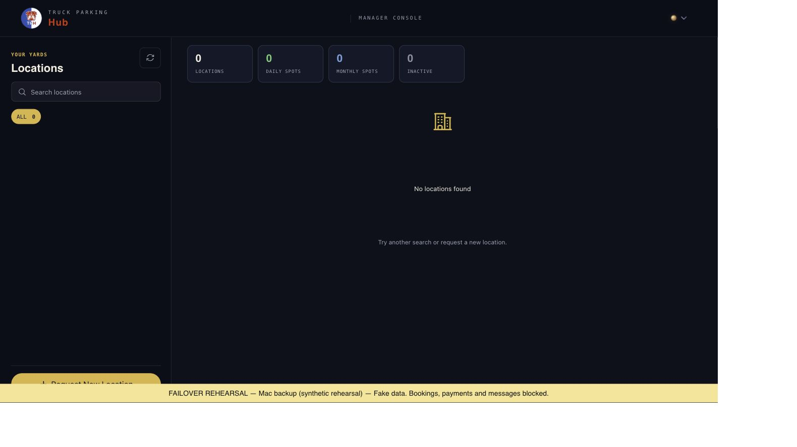
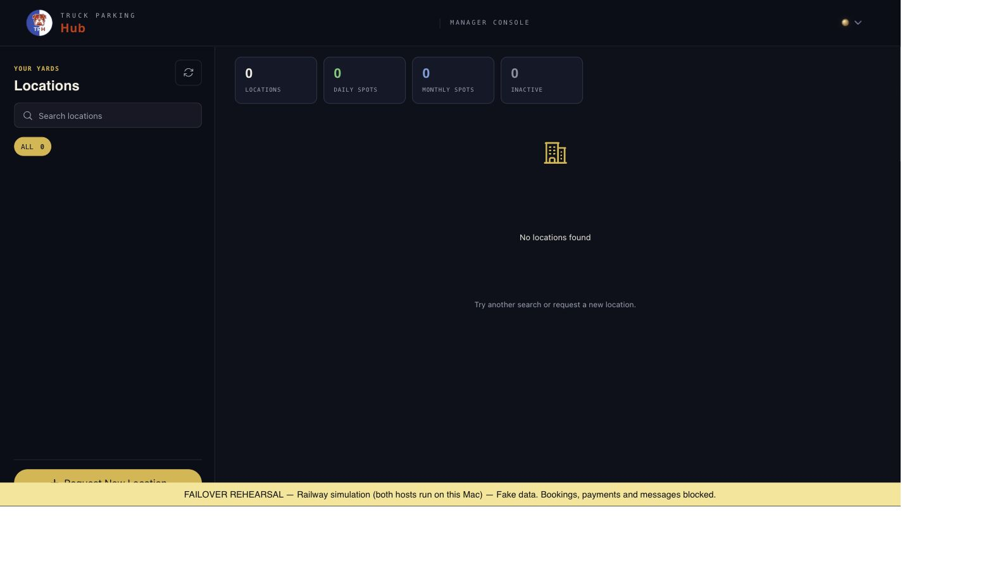

# DB-INFRA-005 — TPH Mac backup rehearsal

Owner: Release & Reliability. Branch: `codex/tph-mac-backup`. Status: synthetic rehearsal accepted; **live backup activation blocked**.

## User requirement and boundary

The user requires zero lost booking records. If current data cannot be proved, activation must refuse. Railway must remain live and untouched during preparation. No production deployment, settings, secret, worker, payment, message, domain or data-export operation was performed.

The real Railway production MongoDB is hosted by Railway. An unchanged primary has no shared fencing contract with this rehearsal. Native payment calls use per-call random keys; native email and worker retries do not consume this new fake-operation ledger. Therefore no test here proves an actual live switch or guarantees production duplicate prevention. Live activation always refuses.

Two real pinned TPH app copies run **on the Mac**, labeled `railway-simulation` and `mac-backup`. The first is not Railway. They share a newly restored synthetic database and a loopback-only ingress. Only public reads and native manager PIN verification are admitted. Native booking/payment/message/webhook/job mutations are denied. No business workers or live credentials enter this rehearsal.

## Verified implementation

- Native source `b369e9f5e28584ba99f1cbe35d8f65080a51aeda`; trusted prior test image `sha256:95df264063f3224f9a2519fd68a99e537f7a8da26d17ff78b5e6a87267a798b0`.
- Rehearsal app image `sha256:ac317d36a53634d90c2a40c9a5dc383e1e9bfc65486c880947582a72513d6fcf`.
- Dedicated root `~/mac-hosting/tph-backup-rehearsal-v3`, project `macapps-tph-backup-rehearsal-v3`.
- One internal Docker network; no direct app/database port. Docker Desktop suppresses the attempted published router port on that network. A reviewed host relay binds only `127.0.0.1:18310`, using structured Docker-exec transport to the exact accepted router instance. No container has a Docker socket.
- Immutable images, sealed file/config hashes, exact accepted container IDs/configs, serialized operator actions and preserved failure/uncertainty journals.
- Durable owner/epoch, admission drain, exact old-container stop proof and target-bound fresh authority/watermark proof. No expiry takeover. Unknown results freeze admission and switching.
- Fake payment/email/SMS/job effects use stable business identifiers and payload binding. They never call a real provider. Definite fake-provider reconciliation records prior acceptance without resending.

## Automated and runtime evidence

Focused suite: 31 tests, including concurrent claims, restart persistence, stale epochs/data, pending/unknown refusal, replaced-target refusal, immutable image/config drift, actual HTTP Host/Origin/framing/header negatives, root webpack asset allowlist and fixed-CID relay transport.

At `2026-10-22T04:59:06.468487Z`, corrected runtime harness passed 28 checks:

- Real `mongodump` of synthetic source and restore into a distinct new database. Source/restored fixture records and created indexes were equal before app startup: 2 parking locations, 1 PIN, 1 settings record.
- Archive SHA256 `9768a3fd4f4e98a4cb246ab00baefa54b5e51cd7094181cc6740977f5d0e8114`; canonical source content/index SHA256 `ab6e9eaf3b8bdb851886e170716c4644f4ddbad392118500e85057de6587acce`.
- Public/hidden filtering, native PIN acceptance before/on backup, and both accepted writes retained on return.
- Pending admission refused switch before stopping the source. Stale owner/epoch refused dispatch.
- Actual source container stopped before target promotion in both directions; epochs 1→2→3.
- Ten concurrent fake payment replays produced one effect. Email/SMS/job each produced one. A separate lost-ack payment was reconciled without another effect.
- Unknown payment froze admissions and refused failback while keeping current source running.
- Router restart retained ownership and deduplication. Final watermark7; admissions2accepted/1rejected; effects5accepted (payments2/email1/SMS1/job1); pending/unknown0.
- All fourteen existing staging/test container identities, start/config/network snapshots and original monitor baseline were unchanged.

Independent QA and Security reviewed source and actual runtime, including private SQLite/provider state, native fixture records, restored indexes, protected snapshots and actual relay HTTP. Both gave **GO for the synthetic rehearsal only**. Both app instances and router returned explicit blocked-egress results. Mongo’s sole internal network was independently verified; a direct Mongo network probe was not accepted as proof.

## Preserved failures and limitations

The initial v1 Mongo startup failed because all capabilities were dropped before the entrypoint tried to switch UID. The v2 setup corrected this with explicit image-verified UID/GID999:999, but seed initialization then hit an existing unsupported native monthlySquareLocationId partial index using `$nin`. Both roots, logs and data remain separate and preserved. The accepted v3 seed disables automatic indexes only during fixture creation and creates valid fixture indexes explicitly. This does not fix or prove complete native Mongo schema/index compatibility.

App startup subsequently added native empty collections and indexes plus operational-log records. Independent QA verified fixture records/indexes were retained; PIN usage/last-used/update metadata changed as expected. Do not claim continuing equality of the entire source/restored index sets or absence of operational logs.

The first v3 HTTP harness failed before any admitted write because internal Docker networking suppressed its published port. A separately hashed fixed-CID transport extension and distinct v2 harness markers corrected this without resetting control data or deleting the first failure. A reviewer’s timed-out read-only Mongo probe left a process; scoped cleanup temporarily raised only this new Mongo PID limit, killed the uniquely matched probe, restored128 and preserved the same database/container. No existing service was restarted.

The final router image is `sha256:ad263a2882720763c4b2ffd920a17571b1777c99110cce02c1ab9272ff3313f2`. A router-only asset correction is separately journaled with prior immutable manifests and unchanged SQLite logical hashes. The first HTTP tests proved SSR but missed native root webpack assets; the final browser acceptance must refer to the corrected router revision, not the earlier image.

## Operations and future live gate

See [operator runbook](../../deploy/tph-mac-backup/README.md). Installed command `~/.local/bin/tph-backup` supports simulation `status`, `switch mac`, `switch railway` and `tunnel`. `activate-live` refuses. Existing public test app/deploy commands are unchanged.

Live readiness requires reviewed durable current data outside the outage domain, real primary/worker/webhook fencing, native provider idempotency/reconciliation, safe recovery of backup writes, production credentials/domain/callback release and an actual release-specific failover/failback rehearsal. Periodic snapshots and DNS reversal cannot satisfy the user’s zero-loss requirement. None of those production prerequisites is silently waived here.

The original 24-hour infrastructure observation continues on its unchanged accepted clock. This task does not complete or reset that window.

The router revision first failed before image/config/container replacement because Docker’s credential helper was missing from PATH. The uncertain marker blocked normal operation. A separately reviewed resume verified archived config hashes, exact native instances and unchanged durable state, supplied the official helper PATH, retained the failed build log, and completed only the router revision. The old relay exited; the new exact relay PID owns only127.0.0.1:18310; representative JS/CSS/AVIF assets and status returned200.

## Final browser and source boundary

After the reviewed router correction, the native manager page hydrated and accepted a synthetic PIN through its real UI. The installed workstation command switched the same session to Mac epoch4 and returned it to Railway **simulation** epoch5. The browser retained its manager session on Mac epoch4 and, after reload and hydration, on returned Railway simulation epoch5. Three total native PIN admissions are accepted, watermark8, five fake effects unchanged, no pending/unknown operation. The restricted manager location query is intentionally denied by the read-only allowlist, so the page displays zero locations; public fixture filtering is separately API-verified. This is session continuity evidence, not complete booking/manager feature acceptance. The Docker-exec browser transport is slow and is not a production performance acceptance.

Active `operator.py`, `relay.py`, control/config/provider code and `build/router.py` are matched to reviewed source. Unused original tools copies of README/tests/router/initial revision/wrapper remain sealed as setup provenance; their bytes are not claimed equal to the final checkout. The installed workstation `~/.local/bin/tph-backup` is the final wrapper and selects the corrected v2 harness. Prior tool/manifests and failed build bytes are retained in the router revision archive.

The normal repository pre-push secret check initially rejected three credential-shaped URL expressions containing placeholders/runtime lookups. Independent Security confirmed no actual secret literal. An explicit `urlunsplit` refactor produces identical full configuration bytes; 31 focused tests pass. Only the two host source files and their manifest hashes were resealed with an archived hash chain; container images/identities and durable state are unchanged. The hook was not bypassed.
